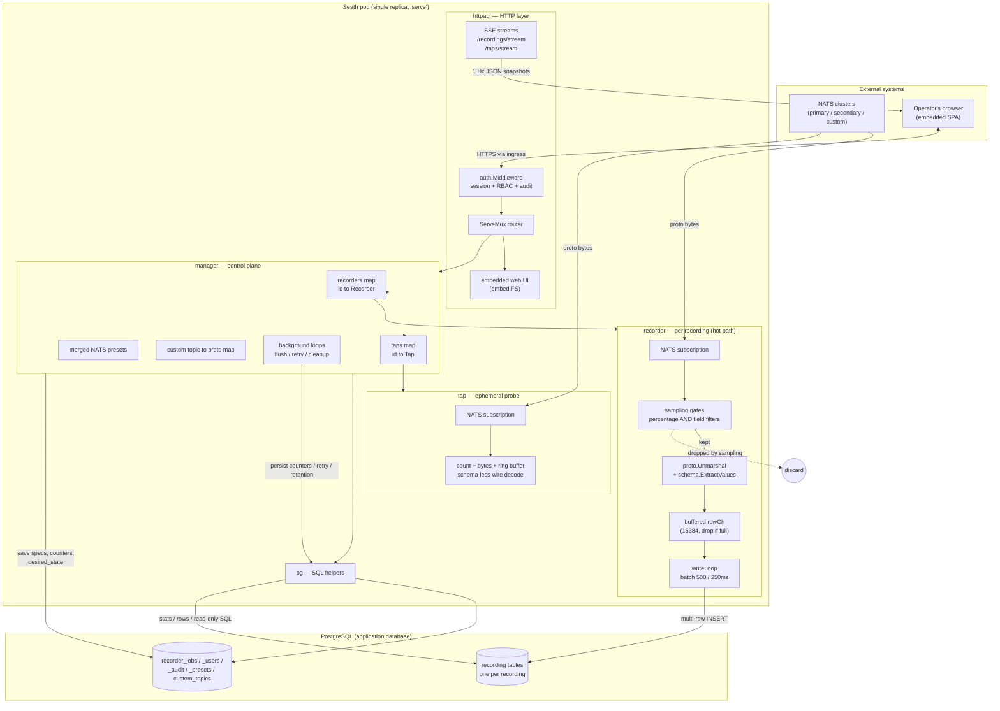
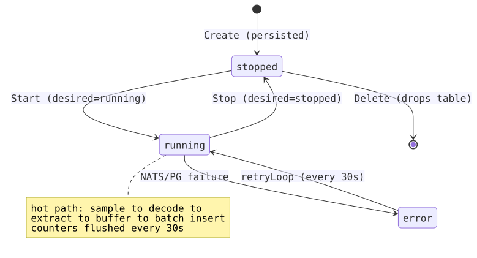
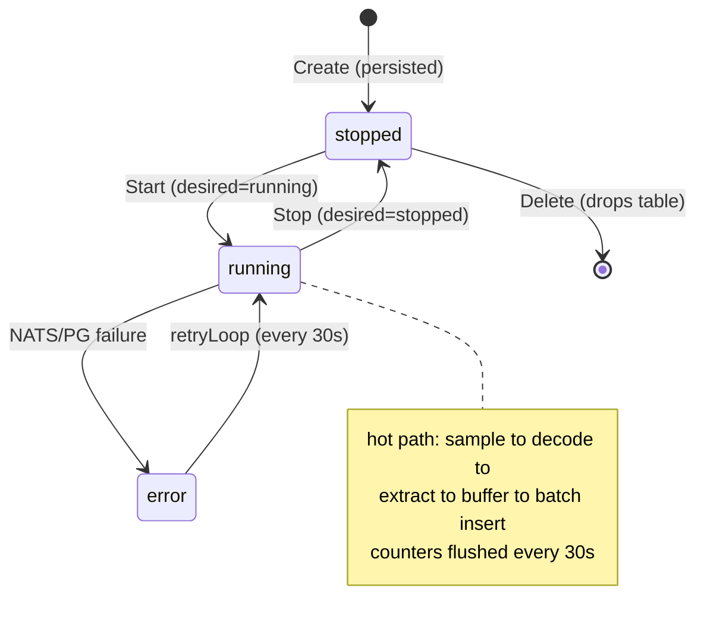

# Seath — Project Deep Dive

> A complete, ground-up analysis of the Seath codebase: architecture, data flow,
> every endpoint, a file-by-file and function-by-function breakdown, a dead-code
> audit, and a prioritized improvement backlog including a concrete Kubernetes
> resource-monitoring design.

**What Seath is, in one paragraph.** Seath is a Go service that subscribes to
NATS subjects, decodes each message as a known Protocol Buffers type, keeps a
configurable percentage of them (sampling), and writes typed rows into
auto-created PostgreSQL tables — one table per "recording". It ships with a
self-contained web console (embedded HTML/CSS/JS, no build step) to create and
control recordings, "tap" arbitrary subjects to see live traffic, browse and
query the captured tables with read-only SQL, manage NATS environments and
runtime topic→proto mappings, and review an audit log. It is named after *Seath
the Scaleless*, the archivist dragon — it watches streams and preserves them.

---

## Table of Contents

1. [Phase 1 — Architecture & Data Flow](#phase-1--architecture--data-flow)
   - [1.1 Data-flow diagram](#11-dataflow-diagram)
   - [1.2 Project structure & architecture](#12-project-structure--architecture)
   - [1.3 API endpoints](#13-api-endpoints)
2. [Phase 2 — File-by-file deep dive](#phase-2--filebyfile-deep-dive)
3. [Phase 3 — Code cleanup & dead code](#phase-3--code-cleanup--dead-code)
4. [Phase 4 — Improvement backlog & K8s monitoring](#phase-4--improvement-backlog--k8s-monitoring)
5. [Appendix — Data model & lifecycle](#appendix--data-model--lifecycle)

---

# Phase 1 — Architecture & Data Flow

## 1.1 Data-flow diagram

The diagram below traces a message from the moment it is published on NATS to
the moment it is read back by a human in the browser, plus the control plane
(the API that creates and manages recordings).


<details><summary>Diagram source (Mermaid)</summary>



</details>

**Three independent data paths to notice:**

1. **Ingest (the reason Seath exists).** NATS → sampling gate → proto decode →
   value extraction → bounded channel → batch writer → one INSERT per ~500 rows
   into the recording's own table. This path is lock-light and built for
   throughput: counters are atomics, the NATS callback never blocks (it drops to
   a counter if the buffer is full), and writes are amortized into batches.

2. **Tap (diagnostics).** A parallel, throwaway subscription that only counts
   messages and keeps the last ~10 payloads for preview, decoding protobuf
   *without* a schema (pure wire-format walk). Taps never touch Postgres and
   never survive a restart.

3. **Control plane / read-back.** The browser talks to the REST API through the
   auth middleware. Live tables (recordings & taps) are pushed to the browser as
   Server-Sent Events once per second; table browsing and the SQL console read
   straight from Postgres in read-only transactions.

## 1.2 Project structure & architecture

```
cmd/
  main.go            CLI entrypoint: serve | start | schema | user
internal/
  config/            YAML + env config loading and table-name sanitization
  natspreset/        NATS environment type + connection auth options
  prototypes/        DB-backed descriptor loading + dynamic message creation
  schema/            proto descriptor → SQL column introspection + value extraction
  pg/                All PostgreSQL SQL: DDL, batch insert, stats, paging, queries
  recorder/          Per-recording lifecycle (subscribe, sample, decode, batch-write)
  manager/           Owns recorders, taps, presets, custom topics; persistence; loops
  auth/              Cookie-session auth, admin/viewer RBAC, audit logging
  httpapi/           REST API + embedded single-page UI (HTML/CSS/JS)
    web/             Static assets, embedded into the binary with go:embed
  sysstat/           cgroup-v2 CPU/memory readings for the console
tools/
  bootstrap.py       explicit, add-only instance bootstrap
configs/
  config.yaml        Example configuration for the headless `start` command
Dockerfile           alpine packaging of the CI-compiled binary
.gitlab-ci.yml       test → bootstrap-test → build → release (tag-gated)
.github/workflows/   public test + build workflow
```

### Architectural patterns

- **Layered / hexagon-ish separation with one-way dependencies.** The dependency
  graph flows in a single direction: `httpapi → manager → {recorder, pg, auth,
  prototypes, topic, natspreset}` and `recorder → {pg, schema, natspreset,
  topic}`. The HTTP layer never speaks SQL directly; it always goes through the
  `manager`, which is the single source of truth for "what recordings exist and
  what are they doing". This keeps the transport (HTTP) swappable and the domain
  logic testable in isolation.

- **Control plane vs. data plane.** `manager` is the control plane: it holds
  definitions, starts/stops things, and persists intent. `recorder` and `tap`
  are the data plane: long-lived goroutines moving bytes. The two communicate
  through small, well-defined method calls and atomics, not shared mutable
  structs.

- **Desired-state reconciliation (Kubernetes-style).** Each recording stores a
  `desired_state` (`running`/`stopped`) in Postgres. On boot, `Reconcile()`
  loads every spec and starts the ones whose desired state is `running`. A
  background `retryLoop` re-starts recordings that *should* be running but are in
  an error state (e.g. NATS was briefly unreachable). This is the same
  "declare intent, converge toward it" model Kubernetes uses — and the reason
  Seath must run as **exactly one replica** (two replicas would both converge the
  same jobs and double-write).

- **Producer/consumer with bounded backpressure.** The NATS callback is the
  producer; `writeLoop` is the consumer. They are decoupled by a buffered channel
  (`rowCh`, capacity 16384). If the consumer falls behind and the buffer fills,
  the producer *drops* (and counts) rather than blocking NATS delivery — a
  deliberate choice that favors visible, bounded data loss over invisible
  latency and reconnect storms.

- **Schema-on-write, driven by reflection.** Rather than hand-maintaining table
  DDL, `schema.Introspect` walks the protobuf descriptor and derives a column
  per field with an inferred SQL type. Recordings can override this (rename,
  exclude, index columns), but the default "just works" for any registered type.

- **Self-contained deployable.** The entire UI is embedded with `go:embed`, so
  the artifact is a single static binary with no external assets, no Node build,
  and no CDN. The Docker image is a CI-compiled binary on top of Alpine.

- **Persistence as plain tables, not migrations framework.** Tables are created
  idempotently with `CREATE TABLE IF NOT EXISTS` plus `ALTER TABLE ... ADD COLUMN
  IF NOT EXISTS` for in-place upgrades. There is no migration tool; the schema
  evolves through additive, idempotent DDL executed at startup.

## 1.3 API endpoints

All routes are served by one `http.ServeMux` (Go 1.22+ method-and-pattern
routing) and wrapped by `auth.Middleware`. Authorization rule of thumb: **GET is
allowed for any logged-in user; every mutating call requires `admin`**, with one
deliberate exception — `POST /api/query` is allowed for `viewer` when
`QUERY_PG_DSN` is set, because it then runs one prepared statement, in a
read-only transaction, as a reader role that can only read recording tables.

### Health & session

| Method & path | Auth | Why it exists / how it works |
|---|---|---|
| `GET /healthz` | public | Liveness. Returns `200 ok` unconditionally — proves the process is up. |
| `GET /readyz` | public | Readiness. Calls `manager.Ping()` → `db.Ping()`; `503` if Postgres is unreachable so Kubernetes won't route traffic to a DB-less pod. |
| `POST /api/login` | public | Authenticates against `recorder_users` (bcrypt). Accepts an HTML form post (so the browser/OS password manager offers to save) or JSON (for API/tests). On success issues an opaque session token in an `HttpOnly` cookie. |
| `POST /api/logout` | public | Deletes the in-memory session and clears the cookie. |
| `GET /api/me` | user | Returns the caller's `{user, role}` (read from the request context the middleware populated). The UI uses it to show the role badge and hide admin-only controls for viewers. |

### Recordings (the core resource)

| Method & path | Auth | Why it exists / how it works |
|---|---|---|
| `GET /api/recordings` | user | List every recording with live status + table stats (`manager.List` → `view` enriches each with `pg.TableStats`). |
| `GET /api/recordings/stream` | user | Same payload as above, pushed as SSE once per second for a live dashboard without polling. |
| `POST /api/recordings` | admin | Create a recording. Validates topic/preset/sample-rate/table, checks for duplicate table names, persists it **stopped**. |
| `GET /api/recordings/{id}` | user | One recording's view. |
| `PUT /api/recordings/{id}` | admin | Edit a **stopped** recording's definition (rejects while running). |
| `DELETE /api/recordings/{id}` | admin | Delete a stopped recording **and drop its Postgres table** (destructive; the UI double-confirms). |
| `POST /api/recordings/{id}/start` | admin | Start recording; sets `desired_state=running`. Idempotent (starting a running one is a no-op success). |
| `POST /api/recordings/{id}/stop` | admin | Stop recording; flush counters; `desired_state=stopped`. |
| `POST /api/recordings/{id}/sample-rate` | admin | Change sampling 1–100% **live** (atomic store, no restart). |
| `GET /api/recordings/{id}/preview` | user | Latest 20 rows (quick modal peek). |
| `GET /api/recordings/{id}/insights` | user | Rich table stats: row count (planner estimate), size, column types, time span. |
| `GET /api/recordings/{id}/rows` | user | Paged rows (`limit`/`offset`/`order`) for the full-page table browser. |

### Taps (ephemeral diagnostics)

| Method & path | Auth | Why it exists / how it works |
|---|---|---|
| `GET /api/taps` | user | List active taps with count/bytes/last-seen + recent sample previews. |
| `GET /api/taps/stream` | user | SSE version of the tap list (1 Hz). |
| `POST /api/taps` | admin | Open a subscription on a subject (NATS wildcards allowed) to check whether anything is publishing. In memory only. |
| `DELETE /api/taps/{id}` | admin | Tear down a tap. |

### NATS environments (presets)

| Method & path | Auth | Why it exists / how it works |
|---|---|---|
| `GET /api/presets` | user | List selectable NATS environments. Credentials are **never** serialized — only `name`, `url`, `has_auth`. |
| `POST /api/presets` | admin | Add/update an environment (persisted to `recorder_presets`, then the live map is rebuilt). |
| `DELETE /api/presets/{name}` | admin | Remove an environment; in-use ones are refused. |

### Proto registry & topic mappings

| Method & path | Auth | Why it exists / how it works |
|---|---|---|
| `GET /api/topics` | user | Every selectable topic from the database-backed mappings. |
| `GET /api/topics/{topic}/schema` | user | The proto→column mapping for a topic plus a suggested sanitized table name; powers the recording builder. |
| `GET /api/proto/modules` | user | Active and staged DB-backed module versions plus the total type count. |
| `POST /api/proto/modules` | admin | Validate and stage an immutable `FileDescriptorSet`; live decoding is unchanged. |
| `PUT /api/proto/modules/{id}/activate` | admin | Atomically activate a module version for future recordings; existing recordings retain pinned schemas. |
| `GET /api/proto/types` | user | Every message type in the active descriptor catalogue. |
| `GET /api/proto/types/{name}/schema` | user | Column preview for any active proto type. |
| `GET /api/topic-mappings` | user | List runtime topic→proto mappings. |
| `POST /api/topic-mappings` | admin | Map a new topic name to an active proto type **without a rebuild** (persisted to `custom_topics`). |
| `DELETE /api/topic-mappings/{topic}` | admin | Remove a custom mapping for future recordings; existing recordings retain pinned schemas. |

### Database utilities & audit

| Method & path | Auth | Why it exists / how it works |
|---|---|---|
| `GET /api/stats` | user | Whole-database on-disk size (`pg_database_size`). |
| `POST /api/query` | admin; viewer only with `QUERY_PG_DSN` | One prepared SQL statement in a **read-only** transaction with a configurable timeout (90s by default) and row cap (15,000 by default). Preparing rejects multi-statement input such as `COMMIT; ...`; with `QUERY_PG_DSN` it runs as a reader role that cannot see internal tables. Powers the SQL console + CSV/JSON export. |
| `GET /api/recordings/{id}/export.csv` | user | Streams every row of a recording table as oldest-first CSV without buffering the whole table in Seath memory. |
| `GET /api/audit` | admin | Recent mutating actions (who/method/path/status). Non-admins get `403`, which the UI uses to silently hide the audit card. |

### Static UI

| Path | Why |
|---|---|
| `GET /` and all other paths | `http.FileServer` over the embedded `web/` FS, with `Cache-Control: no-cache` so a redeploy never serves a stale page. Pages: `index.html` (recordings), `tap.html`, `registry.html`, `table.html`, `login.html`. |

---

# Phase 2 — File-by-file deep dive

For each tracked Go and web file: its purpose, then every function/method and how
it works under the hood.

## `cmd/main.go` — CLI entrypoint

**Purpose.** Wires the four subcommands of the `seath` binary using
`urfave/cli/v3` and configures logging. This is the only `package main`.

- **`main()`** — builds the `cli.Command` tree (`schema`, `start`, `serve`,
  `user`) and runs it; `log.Fatal` on error.
- **`setupLogging()`** — sets the default `slog` text handler; level from
  `LOG_LEVEL` (debug/info/warn/error, default info).
- **`schemaCmd()`** — loads the active descriptor catalogue and topic mappings
  from Postgres. With `--list` it prints stored topics; with `--topic X` it
  creates a dynamic message and prints its column mapping as YAML.
- **`startCmd()`** — the headless `start` command. Loads+validates config,
  installs a SIGINT/SIGTERM-cancelable context, and calls `recorder.Run` to
  record one topic until signaled. (Not used in the Kubernetes deployment, which
  runs `serve`.)
- **`serveCmd()`** — the production command. Loads base config, connects to
  Postgres, builds the `Store` (creates/upgrades the metadata tables), builds the
  `Manager` and calls `Reconcile()` (resume persisted jobs + start background
  loops), builds the `Authenticator`, warns if there are zero users, then starts
  the HTTP server wrapped in the auth middleware. Blocks until the context is
  cancelled, then does a graceful 15s HTTP shutdown and `mgr.Shutdown()`.
  `--addr`/`HTTP_ADDR` sets the listen address (default `:8080`).
- **`userCmd()`** — `user add|list|rm` for managing logins. The local `withDB`
  helper opens a DB connection, ensures the users/audit tables exist, and runs
  the action. `add` reads the password from `--password` or stdin and upserts via
  `auth.AddUser`; `list` prints `username\trole`; `rm` deletes and errors if the
  user didn't exist.

## `internal/config/config.go` — configuration

**Purpose.** Loads YAML config with environment overrides, and provides the
table-name sanitizer. Two entry points so `serve` (which only needs the DSN) and
`start` (which needs a fully validated single-topic config) share code.

- **`LoadBase()`** — starts from `defaults()`, reads `/etc/seath/config.yaml`
  (or `CONFIG_PATH`) if present (missing file is fine), unmarshals YAML, then
  applies env overrides. Returns the config without `start`-specific validation.
- **`Load()`** — calls `LoadBase` then validates for a single-topic run: topic
  required; default table name derived from the topic with a UTC `YYYYMMDD`
  suffix if unset; sample rate must be 1–100.
- **`defaults()`** — NATS `nats://127.0.0.1:4222` core mode, sample rate 100.
- **`applyEnv()`** — overrides from `NATS_ADDRESS`, `NATS_USERNAME`,
  `NATS_PASSWORD`, `NATS_MODE`, `PG_DSN`, `TOPIC`, `TABLE`, `SAMPLE_RATE`.
- **`SanitizeTableName(topic)`** — turns a dotted/dashed/slashed topic
  (`example.events.order.created`) into a valid identifier
  (`example_events_order_created`) by replacing `.`/`-`/`/` with `_`.
- **`SuggestedTableName(topic, now)`** — appends the UTC creation date
  (`_YYYYMMDD`) and truncates the topic portion when necessary so the suffix
  remains inside PostgreSQL's 63-byte identifier limit.

> Types: `Config`, `NATSConfig`, `PostgresConfig` mirror the YAML shape. Note
> `NATSConfig.Mode` (core/jetstream) is parsed but not currently consumed by the
> recorder — see [Phase 3](#phase-3--code-cleanup--dead-code).

## `internal/natspreset/presets.go` — NATS environments

**Purpose.** Defines the NATS environment value and turns its credentials into
connection options. Selectable environments live in `recorder_presets` rather
than being compiled into the binary. Credentials are tagged `json:"-"` so they
can never leak through an API response.

- **`Preset`** (type) — `Name`, `URL`, and unexported-from-JSON `Username`,
  `Password`, `Token`.
- **`BuildOptions(p)`** — converts a preset's credentials into a `[]nats.Option`
  (`nats.Token` or `nats.UserInfo`), used by both the recorder and taps so auth
  handling is identical everywhere.

## `internal/prototypes/prototypes.go` — dynamic proto catalogue

**Purpose.** Validates and merges versioned `FileDescriptorSet` bundles loaded
from Postgres. The immutable `Registry` creates messages with `dynamicpb`, so no
application proto repository or generated package is part of the Seath binary.

- **`Build(modules)`** — deduplicates identical imports, rejects conflicting
  files, links the complete descriptor graph, and builds a candidate registry.
- **`Registry.List()` / `New()` / `Exists()`** — browse, instantiate, and
  validate fully-qualified message names in that immutable catalogue.
- **`Digest()`** — SHA-256 identity for an imported descriptor bundle.
- Types: `TypeInfo`, immutable `Module` metadata, and `Registry`.

## `internal/schema/schema.go` — proto ↔ SQL bridge

**Purpose.** Converts a proto descriptor into column definitions, and a proto
message into a row of values. This is the heart of "schema-on-write".

- **`ColumnDef`** (type) — `Field` (proto field), `Column` (SQL name), `Type`
  (SQL type), `Include`, `Index`. Serializable to both YAML and JSON.
- **`Introspect(msg)`** — walks the message descriptor's fields and emits one
  `ColumnDef` per field, defaulting `Column=Field`, `Include=true`, and `Type`
  from `pgType`.
- **`pgType(fd)`** — maps a proto field descriptor to a SQL type: lists/maps →
  `JSONB`; float/double → `DOUBLE PRECISION`; 32-bit ints/enums → `INTEGER`;
  64-bit ints → `BIGINT`; bool → `BOOLEAN`; string/bytes → `TEXT`;
  `google.protobuf.Timestamp` → `TIMESTAMPTZ`; other messages → `JSONB`.
- **`ExtractValues(msg, cols)`** — returns one value per column, in order, by
  looking each `ColumnDef.Field` up in the message and calling `extractValue`;
  unknown fields yield `nil`.
- **`extractValue(refl, fd)`** — the per-field marshaler. Lists/maps →
  `marshalField` (JSON string). Nested messages → `NULL` if absent, a Go
  `time.Time` for Timestamps, else a `protojson` string. Scalars → the native Go
  value (proto3 defaults like `0`/`false`/`""` are written as-is, not NULL).
- **`marshalField(refl, fd)`** — serializes a repeated or map field to a JSON
  string (message elements via `protojson`, scalars natively).

## `internal/pg/pg.go` — PostgreSQL helpers

**Purpose.** Every SQL statement Seath runs lives here, so the rest of the code
is database-agnostic. Identifiers are quoted with `pq.QuoteIdentifier`; user SQL
runs only in read-only transactions.

- **`reserved`** (var) + **`NormalizeColumns(cols)`** — Seath always adds `id`,
  `received_at`, `nats_subject`. Any proto field colliding with those gets
  `_field` appended. Idempotent and order-preserving, so it can be applied at
  display time and again at insert time without drift.
- **`Connect(dsn)`** — opens and pings a `*sql.DB`.
- **`EnsureTable(db, table, cols, indexTime)`** — builds `CREATE TABLE IF NOT
  EXISTS` with `id BIGSERIAL PK`, `received_at TIMESTAMPTZ`, `nats_subject TEXT`,
  then one column per included field. Optionally indexes `received_at` and any
  column flagged `Index`. All index DDL is `IF NOT EXISTS`, so repeated calls are
  safe.
- **`ensureIndex(db, table, column)`** — creates `idx_<table>_<column>` if
  absent, with quoted identifiers.
- **`DeleteOlderThan(db, table, hours)`** — retention: deletes rows whose
  `received_at` is older than N hours; returns rows deleted; no-op when hours ≤ 0.
- **`Insert(...)`** — single-row insert. **Unused** in the current codebase (see
  Phase 3); `InsertBatch` is the live path.
- **`Row`** (type) — one buffered message: `Subject` + ordered `Vals`.
- **`InsertBatch(db, table, cols, rows)`** — the hot write. Builds one multi-row
  `INSERT ... VALUES (...),(...),...` with `received_at = NOW()` per row and
  `$n::jsonb` casts for JSONB columns. Far cheaper than per-message round-trips.
- **`TableStats(db, table)`** — row count + on-disk size. Uses the planner
  estimate `pg_class.reltuples` (instant on huge tables) and only falls back to
  exact `COUNT(*)` for never-analyzed tables; `estimated` reports which path ran.
  Returns zeroes if the table doesn't exist.
- **`SampleRows(db, table, limit)`** — newest rows (delegates to `Rows` desc).
- **`Rows(db, table, limit, offset, order)`** — generic paged read returning
  `[]map[string]interface{}`; byte columns (JSONB) coerced to strings; empty if
  the table is missing.
- **`Query(ctx, db, sql, timeout, maxRows)`** — runs arbitrary user SQL in a
  **read-only** transaction with configurable timeout and row cap. Full-table
  CSV export uses the same timeout but streams rows instead of buffering them.
  The read-only TX is the security boundary — Postgres
  rejects writes/DDL itself.
- **`ColumnInfo`** + **`TableColumns(db, table)`** — column names/types from
  `information_schema.columns`, ordinal order.
- **`TimeSpan(db, table)`** — first/last `received_at` by `id` (insertion order),
  an index-backed approximation of the table's time range.
- **`DropTable(db, table)`** — `DROP TABLE IF EXISTS` (used on recording delete).
- **`DatabaseSize(db)`** — total DB size via `pg_database_size`.

## `internal/recorder/recorder.go` — per-recording engine

**Purpose.** Owns the lifecycle of a single recording: one NATS subscription
feeding one Postgres table, with sampling, batching, counters, and graceful
drain. Safe for concurrent use.

- **Constants** — status (`stopped`/`running`/`error`), desired
  (`stopped`/`running`), and batch tuning (`writeBufferSize=16384`,
  `writeBatchSize=500`, `writeFlushEvery=250ms`).
- **`JobSpec`** (type) — the persisted definition: id, topic, table, sample
  rate, NATS env, columns, desired state, retention hours, index-time flag.
- **`Snapshot`** (type) — immutable live view: status, received/written/errors/
  dropped, started-at, last error.
- **`Resolver`** (type) — `func(topic) (proto.Message, error)`; abstracts the
  registry vs. custom mappings.
- **`Recorder`** (type) — spec + resolver + a mutex-guarded status block +
  **atomic** counters (`received`, `written`, `errors`, `dropped`) + an atomic
  `sampleRate` (read lock-free on the hot path so it can change live) + cancel/
  done handles.
- **`New(spec, resolve)`** — builds a stopped recorder with the caller's
  database-backed resolver; there is no compiled fallback.
- **`SetSampleRate(rate)`** — stores the atomic and updates the spec under lock;
  takes effect immediately, even mid-recording.
- **`Spec()` / `SetDesired(state)` / `SeedCounters(...)` / `Snapshot()`** —
  guarded accessors; `SeedCounters` restores persisted totals so a restart
  continues rather than zeroing.
- **`setError(...)`** — sets status=error + lastError and returns the error.
- **`Start(parentCtx, dsn, preset)`** — the bring-up. Resolves the proto
  template, introspects columns if none given, connects Postgres, `EnsureTable`,
  connects NATS (infinite reconnect, disconnect/reconnect log handlers),
  subscribes with the sampling handler, flips status to running, and launches
  `writeLoop` in the background. Returns once the subscription is live (or the
  failure that prevented it).
- **`writeLoop(ctx, db, cols, rowCh, sub, nc, done)`** — drains `rowCh` into
  batches, flushing on size (500) or timer (250ms). On `ctx.Done()` it
  unsubscribes, drains whatever is buffered, does a final flush, closes NATS+DB,
  and sets status stopped. `flush()` does the `InsertBatch` and advances either
  `written` or `errors`.
- **`handler(template, cols, rowCh)`** — returns the NATS callback. Increments
  `received`; applies the sampling gate `(n-1)%100 >= rate → drop`; clones the
  template and `proto.Unmarshal`s (decode failure → `errors++`, debug log);
  `schema.ExtractValues`; **non-blocking** send to `rowCh` (full → `dropped++`).
- **`Stop()`** — cancels the context and waits for `writeLoop` to drain, then
  marks stopped. Safe to call when already stopped.
- **`Run(ctx, cfg)`** — standalone single-topic recorder for the `start`
  command: introspects columns from the registry, builds an ad-hoc spec + a
  `config` preset from the YAML, starts, and waits for cancellation. (Not used by
  `serve`.)

## `internal/manager/manager.go` — the control plane

**Purpose.** Owns every recorder, tap, preset, and custom mapping; persists
definitions and counters; runs the background loops; and is the single API the
HTTP layer calls. Concurrency-guarded with an `RWMutex` (recorders/custom), a
separate mutex for taps, and an `RWMutex` for presets.

- **Errors** — `ErrNotFound`, `ErrConflict`, `ErrValidate`, `ErrDuplicate`,
  `ErrInUse`; the API maps these to HTTP status codes.
- **`JobView` / `Stats` / `Mapping` / `Insights`** (types) — API DTOs combining
  recorder state with table stats.
- **`Manager`** (type) — recorders map, custom map, taps map, store, db, dsn,
  root context, and the live DB-backed preset map.
- **`New(...)`** — builds the manager with an empty preset map; reconciliation
  loads environments from the DB.
- **`loadPresets()`** — rebuilds the live preset map from DB presets.
  **`resolvePreset(name)`** performs lookups.
- **`AddPreset(p)` / `DeletePreset(name)`** — validate, persist via the store,
  reload; delete refuses in-use presets.
- **`resolveTopic(t)` / `ResolveTopic(t)`** — registry first, then custom
  mappings (`prototypes.New`).
- **`Topics()`** — union of registry + custom topic names, sorted.
- **`TopicMappings()` / `AddTopicMapping(t, name)` / `DeleteTopicMapping(t)`** —
  CRUD for runtime mappings; add rejects shadowing a built-in topic, unknown
  proto types, and empties; delete refuses while in use.
- **`view(rec)`** — builds a `JobView`, enriching with `pg.TableStats`.
- **`Preview(id, limit)` / `Insights(id)` / `Rows(...)` / `Query(...)` /
  `Stats()`** — read paths that delegate to `pg`.
- **`Reconcile()`** — boot convergence: load presets, custom topics, and every
  persisted job; register each recorder with seeded counters; start those whose
  desired state is running (a failed start is logged, never fatal); then launch
  the three background loops.
- **`cleanupLoop()`** — retention enforcement every 5 minutes via
  `pg.DeleteOlderThan`. Retention is mandatory: every recording has a window of
  1..`MAX_RETENTION_HOURS` hours (default 24).
- **`retryLoop()`** — every 30s, restart recordings that should be running but
  are errored (self-healing after transient NATS outages).
- **`flushLoop()` / `flushAll()` / `flush(rec)`** — every 30s, persist each
  recorder's counters so totals survive an unclean restart.
- **`Ping()`** — DB ping for `/readyz`. **`ListAudit(limit)`** — proxies
  `auth.ListAudit`.
- **`List()` / `Get(id)`** — read recorders.
- **`Create(spec)`** — validate, dedupe table, assign id, persist stopped,
  register.
- **`Update(id, spec)`** — validate, must be stopped, dedupe, persist, re-register.
- **`SetSampleRate(id, rate)`** — live rate change + persist.
- **`Delete(id)`** — must be stopped; delete spec; **drop the table**; unregister.
- **`Start(id)` / `Stop(id)`** — converge one recording and persist desired
  state; `Start` is idempotent, persists intent even if the start fails so
  `retryLoop` can pick it up.
- **`Presets()`** — snapshot copy of the live preset map.
- **`Shutdown()`** — tear down all taps, then stop+flush every recorder
  concurrently.
- **`startRecorder(rec)`** — resolve preset and call `rec.Start`.
- **`validate(spec)`** — topic resolvable, preset known, rate 1–100, table
  non-empty, retention 1..MAX_RETENTION_HOURS hours.
- **`checkDuplicateTable(table, exceptID)`** — guards the one-table-per-recording
  invariant.
- **`newID()`** — 8 random bytes hex.

## `internal/manager/store.go` — persistence

**Purpose.** All reads/writes of the metadata tables (`recorder_jobs`,
`custom_topics`, `recorder_presets`). Definitions and counters live here so
recordings survive restarts.

- **DDL constants** — `createJobsTable`, `alterAddCounters` (additive upgrade for
  counters/retention/index), `createCustomTopicsTable`, `createPresetsTable`.
- **`NewStore(db)`** — runs all four DDL statements idempotently.
- **`PersistedJob`** (type) — a spec + its last-saved counters.
- **Presets** — `LoadPresets()`, `AddPreset(p)` (upsert), `DeletePreset(name)`.
- **Custom topics** — `LoadCustomTopics()` (→ map), `AddCustomTopic(t, name)`
  (upsert), `DeleteCustomTopic(t)`.
- **Jobs** — `Load()` (all jobs + counters, columns JSON-decoded), `Save(spec)`
  (upsert that **resets** counters — a new/edited job starts fresh),
  `SaveCounters(id, r, w, e)`, `SetSampleRate(id, rate)`, `SetDesired(id, state)`,
  `Delete(id)`.

## `internal/manager/tap.go` — ephemeral subscriptions

**Purpose.** The diagnostic "is anything publishing here?" probe. Counts
messages and keeps a small ring buffer of recent payloads, decoding protobuf
*without* a schema. In-memory only.

- **Constants** — `maxSamples=10`, `sampleInterval=150ms` (throttle capture),
  `previewCap=512` (bytes retained per sample).
- **`Tap`** (type) — id/subject/env, atomic count/bytes, a mutex-guarded status
  block + ring buffer, cancel/done handles. **`rawSample`** holds a capped
  payload copy.
- **`TapSample` / `TapView`** (types) — API DTOs; `TapSample` carries `Preview`
  (one-line), `Detail` (pretty decode), and `Hex`.
- **`StartTap(subject, env)`** — validates the subject (no spaces; wildcards OK),
  resolves the preset, connects NATS, subscribes with `handle`, and spawns a
  goroutine that unsubscribes+drains on cancel. Registers the tap.
- **`(*Tap) handle(msg)`** — increments count/bytes; throttled by
  `sampleInterval`, copies up to `previewCap` bytes into the ring buffer.
- **`ListTaps()` / `StopTap(id)` / `(*Tap) stop()` / `stopAllTaps()`** — listing
  (newest first) and teardown.
- **`tapView(t)`** — snapshots a tap and renders each sample's preview/detail/hex.
- **`preview(data)`** — short human view: trimmed string if mostly-printable,
  else schema-less proto wire decode, else hex.
- **`decodeProto(data, depth)`** — walks protobuf wire bytes into `field:value`
  pairs without a schema, inferring types from wire type (varint→int,
  fixed32/64→float, bytes→nested/string/hex). Best-effort; bails to hex on bad
  bytes. **`formatBytesField`** renders a length-delimited field.
- **`detail(data)`** — full payload: text as-is, or `decodeProtoPretty`, or hex.
- **`decodeProtoPretty(data, depth)`** — indented, type-annotated field tree,
  recursing into nested messages.
- **`hexDump(data)`** — classic offset/hex/ASCII dump.
- **`mostlyPrintable(data)`** — ≥90% printable heuristic that decides text vs.
  binary rendering.

## `internal/auth/auth.go` — authentication, RBAC, audit

**Purpose.** Cookie-session auth backed by `recorder_users` (bcrypt), two roles,
and an audit log of mutating actions.

- **Roles** — `admin` (everything), `viewer` (GET, plus the read-only SQL
  console only when `QUERY_PG_DSN` is configured).
- **DDL** — `createUsersTable`, `alterAddRole` (existing users default to admin
  so an upgrade never locks anyone out), `createAuditTable`.
- **`EnsureUsersTable(db)`** — runs the three DDLs.
- **User CRUD** — `User` type; `AddUser` (bcrypt hash, role validation, upsert),
  `RemoveUser`, `ListUsers`, `CountUsers`.
- **Audit** — `AuditEntry` type; `ListAudit(db, limit)` newest-first.
- **`Authenticator`** (type) — db + in-memory `sessions` map (token→{user, exp}).
  **`New(db)`** ensures tables and builds it. Constants: cookie `nr_session`,
  TTL 7 days.
- **`Middleware(next)`** — the gate. Lets through health probes, login/logout,
  and the login page assets; otherwise `resolve`s the session (401 for API,
  redirect for pages); enforces RBAC (non-admins may only GET or POST
  `/api/query`); injects user/role into the context; and **audits** every
  non-GET by wrapping the writer in a `statusRecorder`.
- **`resolve(r)`** — validates the cookie, checks expiry, and **re-reads the role
  from the DB** every request so role changes / removals apply immediately.
- **`handleLogin(w, r)`** — form or JSON; verifies bcrypt; issues a random token
  + HttpOnly SameSite=Lax cookie; audits; redirects (form) or returns JSON.
- **`handleLogout`** — drops the session + clears the cookie.
- **`newToken()`** — 32 random bytes hex. **`writeJSONError`**, the `ctxKey`
  helpers (`RoleFromContext`/`UserFromContext`), `statusRecorder`, and `audit`
  (best-effort insert) round it out.

## `internal/httpapi/server.go` — REST API + UI host

**Purpose.** Maps every route to a manager call, marshals JSON, serves the
embedded UI, and translates manager errors to HTTP codes. (Endpoints are
enumerated in [1.3](#13-api-endpoints); this section covers the mechanics.)

- **`Handler(mgr)`** — registers all routes on a `ServeMux` and mounts the
  embedded `web/` FS at `/` with `Cache-Control: no-cache`.
- **`server`** (type) — wraps the manager. Each handler decodes input, calls the
  manager, and writes JSON.
- **`stream(w, r, snapshot)`** — the SSE engine: sets event-stream headers,
  sends an immediate snapshot, then one per second until the client disconnects.
  Used by `streamRecordings` and `streamTaps`.
- **Helpers** — `decodeSpec`, `writeJSON`, `writeErr`, and `writeManagerErr`
  (the `errors.Is` → status-code switch: NotFound→404, Conflict/Duplicate/InUse→
  409, Validate→400, else 500).

## `internal/httpapi/embed.go`

- **`webFS`** — `//go:embed web` bakes the entire UI directory into the binary.

## Web UI (embedded, no build step)

- **`web/index.html` + `app.js`** — the recordings dashboard: the new-recording
  builder (topic picker → schema table with include/index/rename, preset radio,
  sample slider, retention, index-time), the live recordings table (SSE-driven
  with a polling fallback), the on-the-fly sample-rate modal, and the row-preview
  modal. `app.js` also wires the role badge (`/api/me`), keyboard shortcuts, and
  logout. The preset boxes are fully click-selectable (whole box toggles the
  radio).
- **`web/tap.html` + `tap.js`** — the tap console: start a tap on a subject,
  watch count/rate/bytes live (SSE), and open a message's pretty decode + hex.
- **`web/table.html` + `table.js`** — the per-recording table browser: insight
  stat cards, schema list, paged rows with order/page-size, the read-only SQL
  console (Cmd/Ctrl+Enter to run), and CSV/JSON export.
- **`web/registry.html` + `registry.js`** — active/staged proto modules, the
  descriptor import and activation workflow, searchable topic→proto mappings,
  the NATS-environment manager, and the admin-only audit log.
- **`web/login.html`** — native form POST to `/api/login` (so password managers
  work), with an error banner from the `?error=` query param.
- **`web/style.css`** — the whole design system (dark theme, cards, badges,
  tables, modals, responsive nav). **`web/favicon.svg`** — the dragon mark.

---

# Phase 3 — Code cleanup & dead code

## 3.1 Dead / unused code (safe to remove)

| Item | Location | Evidence | Recommendation |
|---|---|---|---|
| **`pg.Insert` (single-row insert)** | `internal/pg/pg.go` | Zero callers (`grep` finds only the definition; the live write path is `InsertBatch`). | **Delete.** Removes ~30 lines and one easy-to-misuse API. |
| **`schema.go` trailing `var _ = time.Time{}`** | `internal/schema/schema.go:173` | `time` is now genuinely used in `extractValue`, so the keep-alive blank no longer serves a purpose. | Delete the line and the comment. |
| **`NATSConfig.Mode` (core/jetstream)** | `internal/config/config.go` | Parsed from YAML and `NATS_MODE`, but no consumer — the recorder always uses core NATS `Subscribe`. | Either wire JetStream support or drop the field + env override to avoid implying a feature that doesn't exist. |

## 3.2 Conditionally unused in the *current deployment* (keep, but know the status)

These are not dead code, but they are not exercised by the Kubernetes `serve`
deployment. They remain valuable as CLI tooling and should be kept.

- **`start` command + `recorder.Run` + `config.Load`** — the headless
  single-topic recorder. A container deployment runs `serve`; `start` is
  still useful for local/manual captures and is the only consumer of much of
  `config`.
- **`schema` command** — offline proto→column preview. Pure developer tool.
- **`configs/config.yaml`** — only consumed by `start`. It is a synthetic
  *example*, never live configuration.

## 3.3 Working-tree hygiene

A working checkout usually holds files that are **not** part of the project:
vendored dependencies, editor/IDE settings, local tool or agent state, build
output, captured descriptors and database dumps. `.gitignore` lists these
categories and must stay that way.

Two rules follow from that:

1. **Never package the working directory.** Build release artifacts from a clean
   source export (`git archive`, or a fresh clone), never from the directory you
   develop in. The Docker build context is already restricted to application
   code by `.dockerignore`.
2. **Treat local tool state as untrusted for publication.** Editor histories,
   shell snapshots and agent session logs can contain pasted credentials. They
   are gitignored on purpose; do not relax that, and do not copy them into an
   archive or image.

---

# Phase 4 — Improvement backlog & K8s monitoring

## 4.1 Prioritized improvement backlog

### P0 — correctness & safety

1. **Singleton enforcement.** The single-writer invariant (one replica) is only
   enforced by deployment configuration today. Add a Postgres advisory lock
   (`pg_try_advisory_lock`) on boot so a second `serve` process refuses to run
   recorders — defense in depth against an accidental scale-up or an overlapping
   rollout. Pairs with the existing `Recreate` deploy strategy.
2. **Identifier validation on table names.** Table names come from user input and
   are interpolated into DDL in a few places. `pq.QuoteIdentifier` is used for
   most, but `EnsureTable`/`InsertBatch` build names via `fmt`. Add a strict
   `^[a-z_][a-z0-9_]*$` validator at the manager boundary to remove any doubt.
3. **Graceful NATS slow-consumer handling.** Today a full `rowCh` drops messages.
   Add a per-recording "dropped in last minute" gauge and surface it as a UI
   warning + optional Prometheus metric, so silent loss becomes visible.

### P1 — observability

4. **Prometheus `/metrics`.** Export per-recording received/written/errors/
   dropped, write-batch latency, NATS connection state, and DB pool stats. This
   slots into any Prometheus setup that already scrapes the pod.
5. **Resource monitoring in the UI** — see [4.2](#42-kubernetes-resource-monitoring) (designed below).
6. **Structured request logging + trace IDs** for the API.

### P1 — features

7. **JetStream support.** Honor `NATSConfig.Mode` (currently parsed, unused):
   durable consumers + replay would let Seath backfill, not just tail.
8. **Column transforms.** Allow simple per-column expressions (e.g. epoch→
   timestamp, enum→label) at extract time.
9. **Export the whole table**, not just the current page, via a streaming
   `COPY ... TO STDOUT` CSV endpoint.
10. **Recording templates / clone** — "record this topic like that one".

### P2 — platform & DX

11. **Tests.** Unit tests run without a database. Ongoing targets:
    `schema.Introspect`/`ExtractValues`, the sampling gate math, `InsertBatch`
    SQL generation, and `config` env overrides.
12. **Secrets at rest.** Done: with `SEATH_SECRET_KEY`, preset passwords and
    tokens are AES-256-GCM encrypted (`internal/secretbox`). Still open:
    automated key rotation.
13. **Seed required NATS environments during provisioning** so a fresh DB is
    ready without compiling infrastructure endpoints into the application.

## 4.2 Kubernetes resource monitoring

**Goal.** Show, live in the UI, the pod's CPU and memory usage vs. its
configured limits — without depending on `metrics-server` or extra RBAC.

**Feasibility.** Seath runs as a single container. Where cgroup v2 is mounted
read-only at `/sys/fs/cgroup`, the container can read its own usage and limits
directly:

| Source file | Meaning | Shape of the value |
|---|---|---|
| `/sys/fs/cgroup/memory.current` | current memory bytes | integer bytes |
| `/sys/fs/cgroup/memory.max` | memory limit bytes | integer bytes, or `max` when unlimited |
| `/sys/fs/cgroup/cpu.max` | `quota period` (µs) | e.g. `50000 100000` → 0.5 CPU; `max` when unlimited |
| `/sys/fs/cgroup/cpu.stat` → `usage_usec` | cumulative CPU µs | monotonic; rate over an interval = cores used |

Because these are local file reads, **no `metrics.k8s.io` access, no
`metrics-server`, and no new RBAC are required.** This is the cleanest possible
approach and works the same in any cgroup-v2 cluster.

### Design

Add a small `internal/sysstat` package and a `GET /api/system` endpoint (viewer-
readable). The handler reads cgroup files, computes CPU usage as a delta between
two `usage_usec` samples ~250 ms apart, and reports memory current/limit. The UI
adds two gauges to the registry (or a new "System" card) fed by the existing
1 Hz SSE pattern, or a simple 2 s poll.

**`internal/sysstat/sysstat.go` (new):**

```go
// Package sysstat reads this container's cgroup v2 CPU and memory accounting.
// It needs no Kubernetes API access — only the read-only /sys/fs/cgroup mount.
package sysstat

import (
	"os"
	"strconv"
	"strings"
	"time"
)

// Sample is a point-in-time view of container resource use vs. its limits.
type Sample struct {
	MemoryBytes      int64   `json:"memory_bytes"`
	MemoryLimitBytes int64   `json:"memory_limit_bytes"` // 0 = unlimited
	MemoryPercent    float64 `json:"memory_percent"`
	CPUCores         float64 `json:"cpu_cores"`        // cores used over the sample window
	CPULimitCores    float64 `json:"cpu_limit_cores"`  // 0 = unlimited
	CPUPercent       float64 `json:"cpu_percent"`      // of the limit
}

const base = "/sys/fs/cgroup"

func readInt(path string) (int64, bool) {
	b, err := os.ReadFile(path)
	if err != nil {
		return 0, false
	}
	n, err := strconv.ParseInt(strings.TrimSpace(string(b)), 10, 64)
	return n, err == nil
}

// cpuUsageMicros returns cumulative CPU time (usage_usec) from cpu.stat.
func cpuUsageMicros() (int64, bool) {
	b, err := os.ReadFile(base + "/cpu.stat")
	if err != nil {
		return 0, false
	}
	for _, line := range strings.Split(string(b), "\n") {
		if strings.HasPrefix(line, "usage_usec ") {
			n, err := strconv.ParseInt(strings.TrimSpace(line[len("usage_usec "):]), 10, 64)
			return n, err == nil
		}
	}
	return 0, false
}

// cpuLimitCores parses cpu.max ("quota period"; "max" period = unlimited).
func cpuLimitCores() float64 {
	b, err := os.ReadFile(base + "/cpu.max")
	if err != nil {
		return 0
	}
	f := strings.Fields(strings.TrimSpace(string(b)))
	if len(f) != 2 || f[0] == "max" {
		return 0
	}
	quota, err1 := strconv.ParseFloat(f[0], 64)
	period, err2 := strconv.ParseFloat(f[1], 64)
	if err1 != nil || err2 != nil || period == 0 {
		return 0
	}
	return quota / period
}

// Read samples CPU over `window` (block briefly) and memory instantaneously.
func Read(window time.Duration) Sample {
	var s Sample

	if cur, ok := readInt(base + "/memory.current"); ok {
		s.MemoryBytes = cur
	}
	if max, ok := readInt(base + "/memory.max"); ok { // "max" file may be literal "max"
		s.MemoryLimitBytes = max
	}
	if s.MemoryLimitBytes > 0 {
		s.MemoryPercent = float64(s.MemoryBytes) / float64(s.MemoryLimitBytes) * 100
	}

	if u0, ok := cpuUsageMicros(); ok {
		time.Sleep(window)
		if u1, ok := cpuUsageMicros(); ok {
			s.CPUCores = float64(u1-u0) / float64(window.Microseconds())
		}
	}
	s.CPULimitCores = cpuLimitCores()
	if s.CPULimitCores > 0 {
		s.CPUPercent = s.CPUCores / s.CPULimitCores * 100
	}
	return s
}
```

**Wiring (in `internal/httpapi/server.go`):**

```go
mux.HandleFunc("GET /api/system", s.system)
// ...
func (s *server) system(w http.ResponseWriter, _ *http.Request) {
	writeJSON(w, http.StatusOK, sysstat.Read(250*time.Millisecond))
}
```

**UI.** Add two gauges (memory %, CPU %) to `registry.html`, fed by a 2 s poll of
`/api/system`, rendering `cpu_cores`/`cpu_limit_cores` and
`memory_bytes`/`memory_limit_bytes`. No new dependencies.

**Caveats.** `memory.max` can be the literal string `max` (unlimited) — guard the
parse (the helper returns "not ok" and `MemoryLimitBytes` stays 0). The 250 ms
sample blocks one request goroutine briefly; keep it modest and don't put it on
the 1 Hz SSE if you want to avoid steady CPU cost. If the cluster ever runs
cgroup v1, add a v1 fallback (`memory.usage_in_bytes`, `cpuacct.usage`).

---

# Appendix — Data model & lifecycle

### Metadata tables (created idempotently at startup)

| Table | Owner package | Purpose |
|---|---|---|
| `recorder_jobs` | `manager/store.go` | Recording definitions + persisted counters + `desired_state` + retention/index flags. |
| `custom_topics` | `manager/store.go` | Runtime topic→proto-name mappings. |
| `recorder_presets` | `manager/store.go` | All NATS environments (name/url/credentials). |
| `recorder_users` | `auth/auth.go` | Logins (bcrypt) + role. |
| `recorder_audit` | `auth/auth.go` | Mutating-action log (ts/user/method/path/status). |
| *one per recording* | `pg/pg.go` | The captured data: `id`, `received_at`, `nats_subject`, then one column per included proto field. |

### Recording state machine



<details><summary>Diagram source (Mermaid)</summary>



</details>

### Why exactly one replica

The recorder is a single writer that converges `recorder_jobs.desired_state`
in-process. Two replicas would each subscribe to the same subjects and both
write — duplicating rows and doubling NATS load. This is enforced operationally
(one replica, `Recreate` rollout strategy) and is the recommended target for
the P0 advisory-lock hardening above.
```
